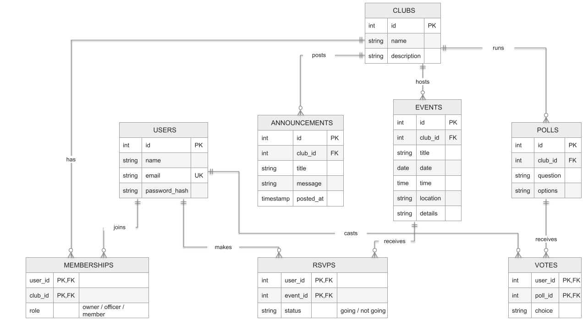
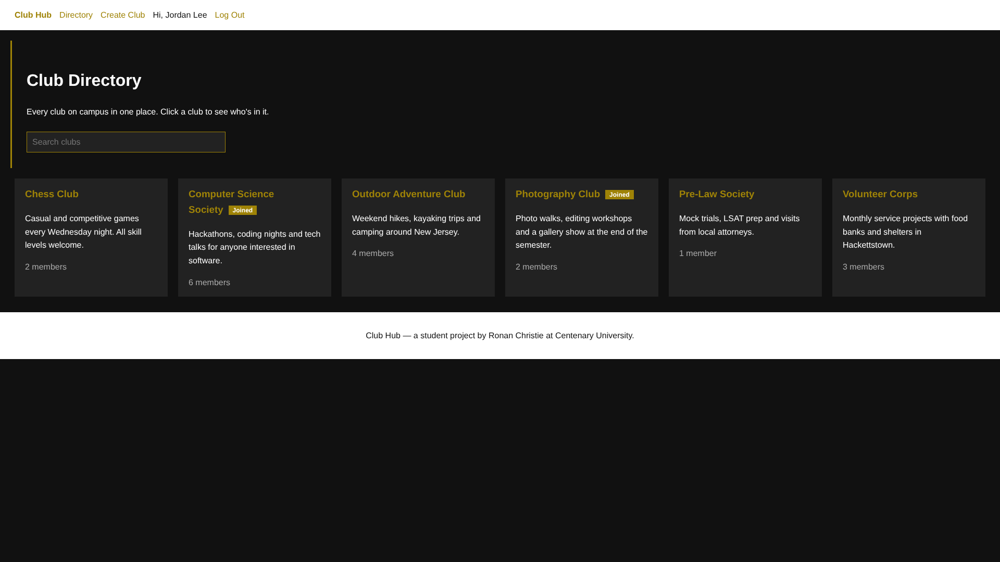
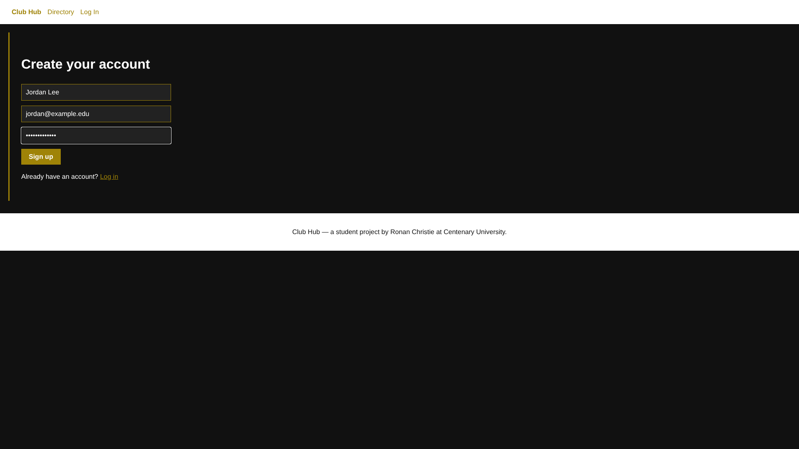
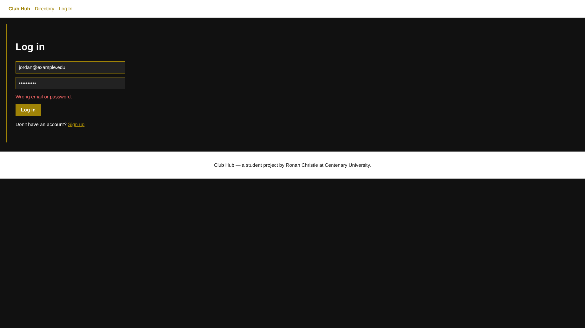
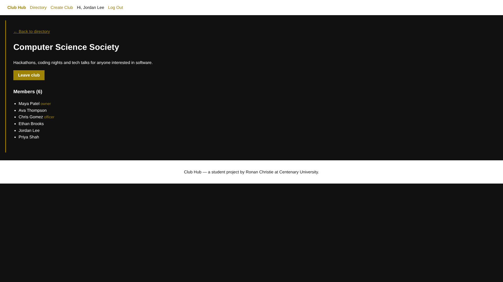
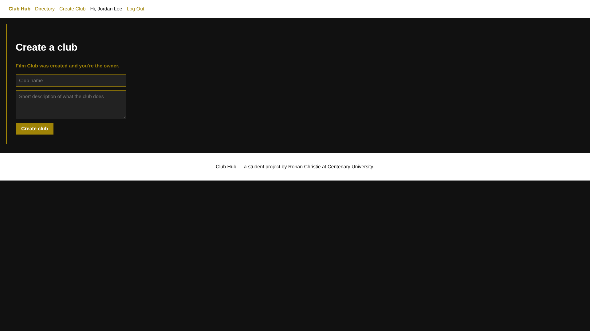
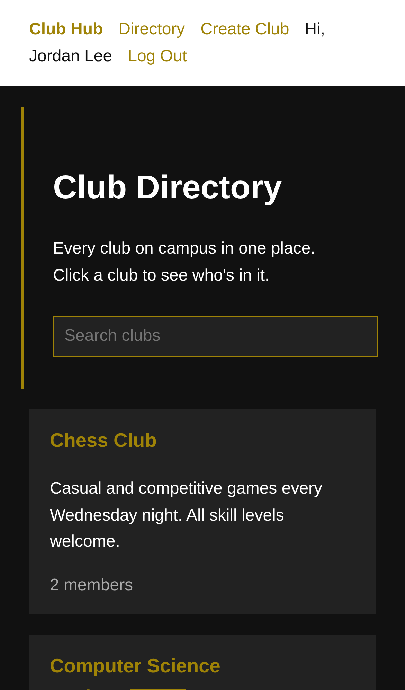

# Club Hub

Club Hub is an all-in-one communication hub for college clubs. Each club gets its own page where students can find it, join it and stay in the loop, instead of club news being scattered across group texts, emails. Sprint 1 (this MVP) covers accounts, the club directory, creating a club and joining or leaving clubs. The goal is to help Club organizers and members in College to have an easier time with communication within small groups while offering an anxiety free club browsing experience to decide what fits best for you.

# Why Use It
This project is used to build upon my experience in college and the issues I faced. The term "Networking" is thrown around constantly in all college programs but making friends and connections are two different things finding people interested in the same thing as you is hard nowadays this fixes that. The Club-Hub platform is going to help you connect with Career relevant groups and help grow your professional network locally.

## Deployed Link: https://club-hub-jbam.onrender.com/#

## How it works
- **Accounts (CH1):** students sign up with a name, email and password. Passwords are hashed with bcrypt before they're stored, and logging in returns a JWT (login token) that the React app sends with every request. Signing up with an email that already exists, or logging in with the wrong info, shows an error message. This is to insure no vulnerabilities for specific user information throughout the platform with logged in users.
- **Club directory (CH2):** the home page lists every club with its name and short description, plus a search box. Clicking a club opens its page with the description and member list. This is to give students the ability for a remote club fair for people who couldnt attend the one their campus held or someone who might be socially anxious in group enviornments like that.
- **Join / leave (CH3):** a logged-in student clicks **Join club** and shows up in the member list right away. **Leave club** removes them. The directory marks clubs you've already joined. This will also allow users to Join multiple clubs without conflict.
- **Create a club (CH4):** any logged-in student can create a club with a name and description. The creator automatically becomes the club's owner and the club shows up in the directory. Im still considering reframing how this works because of official SGA paperwork I dont want not legally established student organizations on a platform meant for the school.
- **Data:** PostgreSQL stores `users`, `clubs` and `memberships`. `memberships` uses a composite primary key (user + club), so the database itself stops someone from joining the same club twice. Roles (`owner`, `officer`, `member`) are already in the table for Sprint 2 permissions. The clubs will also be able to link multiple clubs to individual users.
- **Errors:** every error from the API comes back as `{ "error": "message" }` with the matching status code (400, 401, 404, 409, 500), and the React app shows that message to the user. Reflecting what the actual error was weither its syntax errors a runtime error or a failed fetch of information.
- **Tests:** `npm test` runs the Jest tests for the back end. That will be eventually made into a workflow in Github Actions to automate bug testing before pushes to prod.

## Tech Stack

<table>
<tr>
<td width="25%" valign="top"><strong>Planned Tech Stack</strong></td>
<td width="75%">
Front End- React (Vite), React Router and Axios<br>
  Back End- Node.js and Express REST API with officer role checks<br>
  Database- PostgreSQL (events, RSVPs, announcements and polls tables)<br>
  Testing- Jest + Supertest with integration tests against a real PostgreSQL database<br>
  Deployment- Docker + GitHub Actions + Google Cloud<br>
  AI- Continued use for help with major edge case bugs
</td>
</tr>
</table>

## Live Demo

Link- DEPLOYED_URL_HERE

*(I have a free tiered Render account which says if not very active a URL can take up to 3-5 minutes to load so just be aware.)*

## Run Locally

You need Node.js 18 or newer. Install everything, build the React front end, then start the server:

```bash
npm install
npm run build
npm start
```

Then open:

```text
http://localhost:3000
```

You also need a PostgreSQL database. Copy `.env.example` to `.env`, put your database URL in `DATABASE_URL`, then run `server/src/db/schema.sql` once to create the tables.

## How to Use

1. Sign up with a name, email and password (8+ characters).
2. Create a club with a name and description. You become the owner.
3. Find clubs in the directory with the search bar and click one to open its page.
4. Click Join club or Leave club and the member list updates right away.

## Publish With Render

1. Push the code to the `main` branch on GitHub.
2. In Render, click `New` -> `PostgreSQL` to create the database and copy its URL.
3. Click `New` -> `Web Service`, pick this repository, set the build command to `npm install && npm run build` and the start command to `npm start`.
4. Add `DATABASE_URL` and `JWT_SECRET` under `Environment`, then deploy and open the Render URL.
5. Every merge into `main` redeploys the site automatically.

## Architecture

The app uses the **MVC** (Model-View-Controller) pattern so the data, the logic and the user interface are kept separate: React page -> `routes.js` -> controller -> model -> PostgreSQL.

- **Models** (`server/src/models/`): `userModel.js` and `clubModel.js` hold all the SQL, so nothing else talks to the database directly.
- **Views** (`client/src/pages/`): the React pages `Login`, `Directory`, `ClubPage` and `CreateClub`. They call the API through `api.js` (Axios).
- **Controllers** (`server/src/controllers/`): `authController.js` and `clubController.js` check the input, call the models and send back the response.
- **Middleware** (`server/src/middleware/auth.js`): checks the JWT login token before protected routes like joining or creating a club.

I picked raw SQL with `pg` over an ORM because I'm more comfortable with SQL, and one Render service serves both the API and the React app so there's only one URL.

### Database



Only USERS, CLUBS and MEMBERSHIPS are built in Sprint 1. The rest are planned for Sprints 2 and 3.

## Privacy

Passwords are hashed with bcrypt and never sent back by the API. Secrets like `JWT_SECRET` and the database URL live in environment variables, never in the code. No analytics or tracking is used.

## Development Check

Run the tests with:

```bash
npm test
```

The tests in `server/tests/` use Jest + Supertest. They cover both success and failure cases like signing up, duplicate emails, wrong passwords, creating clubs, joining twice, leaving and protected routes without a login.

## Screens

### Club Directory

The home page lists every club with a search bar. Clubs you've joined are marked.


### Sign Up / Log In

Create an account or log in. Wrong info or a duplicate email shows an error.



### Club Page

Shows the club's description and member list with the Join / Leave button.


### Create a Club

Enter a name and description, and you become the club owner.


### Mobile

The main focus is to have a set view for the Webpage view on Desktop and then modify the front-end to work well with mobile phones.


## Troubleshooting

- **`Cannot find module`:** run `npm install`, then `npm run build`.
- **Blank page:** the React app isn't built yet, run `npm run build`.
- **`ECONNREFUSED 127.0.0.1:5432`:** PostgreSQL isn't running or `DATABASE_URL` in `.env` is wrong.
- **Port 3000 already in use:** set `PORT=3001` in `.env`.
- **"Session expired":** log out and log back in.

## Known Limitations
- Only the club owner role is used so far. Officer permissions come in Sprint 2.
- The owner can't leave or transfer ownership yet, and clubs can't be edited or deleted.
- The login token is stored in `localStorage` (an httpOnly cookie is planned).
- No password reset or email verification yet.
- Render's free tier slow starts and the free database expires after 30 days.

## Planned Features
- Sprint 2: events with date, time and location (CH5), RSVPs with counts (CH6), announcements (CH7), officer permissions and directory filters
- Sprint 3: polls with one vote per member (CH8), Docker, GitHub Actions running the tests on every pull request, Google Cloud deployment
- Email notifications for announcements and events
- Getting the clubs at Centenary University using it and collecting their feedback

## Author

Ronan Christie · [GitHub](https://github.com/Ronan-Chr) · [LinkedIn](https://linkedin.com/in/ronan-christie-b4a9bb24a)
